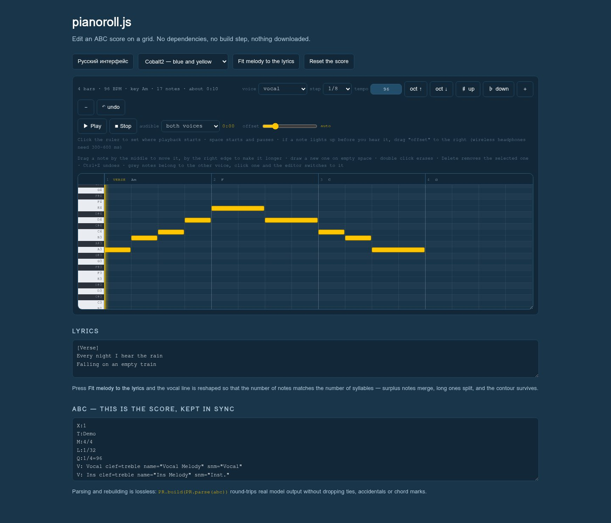

# pianoroll.js

A piano-roll editor for **ABC notation** scores. Drag notes on a grid, hear them play,
and get valid ABC back out. One JS file, one CSS file, no dependencies, no build step,
nothing fetched at runtime.

It was written for a working product — editing the scores that music-generation models
emit — so it handles the awkward parts those models produce: ties across bar lines,
explicit accidentals, chord symbols, section markers, two voices.



**[Live demo](demo/index.html)** — clone the repo and open it, or serve the folder.

---

## Why this exists

Models that generate songs increasingly expose the score as ABC text, which is great for
machines and hopeless for humans: nobody wants to fix a melody by editing
`"Am"A,8B,8C8D8|"F"E16D16|`. Existing ABC tools render notation beautifully but are built
around engraving, not around dragging a note half a beat to the left.

This is the other half: a grid you edit with the mouse, with the ABC kept in sync.

Two things here are not obvious and took real work:

**The round-trip is lossless.** Parse to a note model and build back, and you get a score
the model still understands. Ties survive bar lines and line breaks. Accidentals are
always written explicitly, so a note never changes pitch because a key signature was
re-read differently. Overlapping notes are separated rather than silently dropped.

**Melody can be fitted to lyrics.** When a phrase has more notes than the line has
syllables, a singing model fills the gap with words that do not exist — the output turns
to gibberish. `PR.fitToLyrics()` reshapes the *melody* instead of the words: surplus notes
merge (shortest pairs and repeated pitches first), long notes split, and syllables are
distributed across phrases in proportion to their length. The contour and rhythm survive.

Syllables are counted per script, because one rule for both is wrong. In Cyrillic every
vowel letter is its own syllable, adjacent ones included — `моя` is two, `аэропорт` is
four. In Latin a run of vowels collapses into one and a silent trailing `e` is dropped,
so `rain` and `come` are one each. Russian comes out exact; English is a good
approximation, which is all a letter-based counter can honestly promise.

---

## Quick start

```html
<link rel="stylesheet" href="pianoroll.css">
<script src="pianoroll.js"></script>

<div id="roll"></div>

<script>
  const state = PR.parse(abcText);
  const api = PR.mount(document.getElementById('roll'), state, () => {
    console.log(PR.build(state));   // called after every edit
  });
</script>
```

In Node (for tests or server-side processing) everything except `PR.mount` works:

```js
const PR = require('./pianoroll.js');
const score = PR.parse(abc);
console.log(score.bars, score.tempo, score.keyName);
console.log(PR.build(score) === abc ? 'round-trip is exact' : 'normalised');
```

---

## API

| Call | What it does |
|---|---|
| `PR.parse(abc)` | ABC text → score model `{tracks, bars, tempo, key, keyName, chords, sections, …}` |
| `PR.build(state)` | score model → ABC text |
| `PR.mount(host, state, onChange)` | renders the editor into `host`; returns `{redraw, state, ui, stop}` |
| `PR.fitToLyrics(state, lyrics, voice)` | reshapes a voice to match the syllable count; returns a report |
| `PR.transposeKey(key, semitones)` | transposes a key, spelled the way humans write it (no `Fb`, no `E#`) |
| `PR.syllables(line)` | syllable count for a line of lyrics |
| `PR.lyricLines(text)` | lyric lines with section tags and blanks removed |
| `PR.midiName(m)` / `PR.isBlack(m)` / `PR.keyName(k)` | small helpers |

`PR.fitToLyrics` returns
`{ok, before, after, syllables, lines, phrases, touched, exact}` — or `{ok:false, error}`.

### Editing

Drag a note by the middle to move it, by the right edge to lengthen it. Draw on empty
space to add one, double-click to erase, `Delete` removes the selection, `Ctrl+Z` undoes.
Grey notes belong to the other voice — click one and the editor switches to that voice.
Space starts and pauses playback; clicking the ruler sets where playback begins.

### Playback

Plain Web Audio oscillators, so there is no soundfont to download. The highlight follows
the sound rather than the scheduling clock, and an **offset** slider compensates for output
latency — wireless headphones typically need 300–600 ms. The chosen value is remembered.

---

## Configuration

```js
PR.config.locale     = 'ru';                 // 'en' (default) or 'ru'; add your own to PR.i18n
PR.config.storageKey = 'my_app_nudge';       // where the playback offset is remembered
PR.config.ask        = async opts => { … };  // your dialog instead of window.prompt
PR.config.toast      = msg => { … };         // your notification instead of console.warn
```

Colours come from CSS variables with built-in fallbacks — `var(--accent, #5ad1ff)` — so
the editor looks right on a bare page and adopts your palette if you already define those
names. It never defines them itself, which would override a host theme. Class names are
all prefixed `pr-`.

Height is `var(--pr-height, 320px)`, and the editor can be dragged taller by its
bottom-right corner; the size someone picks is remembered. Width fills the container: a
score narrower than the viewport is stretched to fit, a longer one keeps its detail and
scrolls.

---

## Tests

```sh
npm test      # or: node test/test.js
```

Parsing, the lossless round-trip, syllable counts and melody fitting all run without a
browser, so the claims above are checked rather than asserted.

---

## Scope, honestly

This targets a **narrow ABC dialect**: two voices, durations in units of `L:`, rests `z`/`Z`,
ties `-`, chord symbols in quotes, sections as `% name` lines. That is what song-generation
models emit. It is not a general ABC engraver — no ornaments, tuplets, grace notes, lyrics
alignment under staves, or multi-stave layouts. Feed it an arbitrary ABC file from the wild
and the parts it does not understand are skipped rather than preserved.

Requires a modern browser (Web Audio, CSS grid, ES2020). No IE, no polyfills.

---

## Where it comes from

Built for our own songwriting studio and used in production there, by
[SiliconSense](https://siliconsense.club) — a catalogue of style references and audio
tools for people who write songs.

## Licence

MIT. Do what you like; attribution appreciated, not required.
